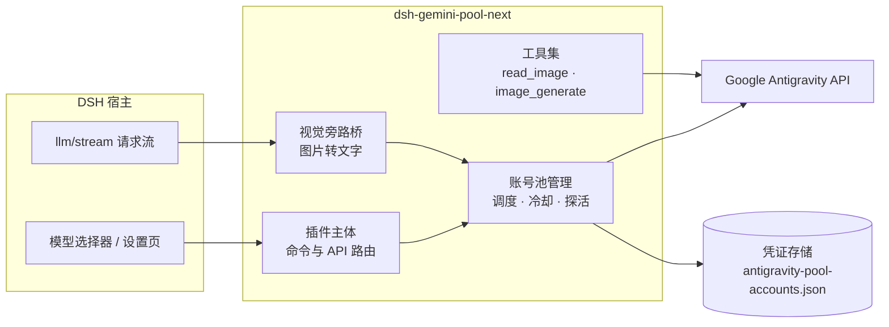

<div align="center">

# dsh-gemini-pool-next

**DSH 用上 Gemini 的方式 —— 让你的 Google AI Pro 订阅，成为编程模型池**

[English](./README.en.md) · **简体中文**

<a href="https://github.com/Q2297045667/dsh-gemini-pool-next/releases"></a>
<a href="https://github.com/Q2297045667/dsh-gemini-pool-next/stargazers"></a>
<a href="https://github.com/Q2297045667/dsh-gemini-pool-next/issues"></a>
<a href="./LICENSE"></a>
<a href="https://github.com/Q2297045667/dsh-gemini-pool-next/commits/master"></a>
<a href="https://github.com/Q2297045667/dsh-gemini-pool-next/actions/workflows/check.yml"></a>

[Issues](https://github.com/Q2297045667/dsh-gemini-pool-next/issues) ·
[讨论区](https://github.com/Q2297045667/dsh-gemini-pool-next/discussions) ·
[更新日志](./CHANGELOG.md) ·
[安全策略](./SECURITY.md) ·
[DeepSeek Harness](https://github.com/deepseek-ai/deepseek-harness) ·
[上游项目](https://github.com/LiZhenNet/dsh-antigravity)

</div>

---

## ✨ 这是什么

[DeepSeek Harness（DSH）](https://github.com/deepseek-ai/deepseek-harness) 本身无法直连 Gemini。这个插件补上这条通路：通过 Google Antigravity / Cloud Code Assist 通道，把你已有的 **Google AI Pro 订阅**直接接入 DSH。不用另买 API key，订阅额度即用即扣。

Gemini 的强项正好落在编程场景上：**多模态**看图、**前端与 UI** 代码生成质量出色，还能**生图**做界面素材。装上插件后，这些能力按订阅额度直接在 DSH 里使用。

不止一个 Google 账号？全部加进来组成**账号池**：额度自动均衡、429 无感切换、坏账号自动冷却与探活恢复。设置页里每个账号一张卡片，每周与 5 小时额度实时可见。

<p align="center">
  
</p>

## 🆚 为什么需要它

装与不装，同一个 Google AI Pro 订阅是两种用法：

| | 不装：订阅只在网页版 | 装：订阅接入 DSH |
|---|:---:|:---:|
| Gemini 多模态（看图） | ❌ 编程时用不上 | ✅ 对话里直接丢图 |
| 前端 / UI 代码生成 | ❌ 网页版没有工程上下文 | ✅ 直接读懂你的项目 |
| 生图做界面素材 | ⚠️ 来回切换复制 | ✅ `antigravity_image_generate` 自动出图入库 |
| 多账号额度 | — | ✅ 全池调度，429 无感切换 |
| 额度情况 | ❌ 黑盒 | ✅ 每账号实时额度条 |
| 坏账号 | ❌ 反复撞死号 | ✅ 自动禁用 + 探活复活 |

主模型本身没有视觉能力（纯文本模型）时，贴图会由池内 Gemini 自动转述成文字回喂主模型，默认开启，详见「👁 无视觉主模型的看图旁路」。

> 使用本插件前，请先阅读下方的「⚠️ 封号风险」。

## ⚠️ 封号风险，使用前必读

本插件是非官方第三方工具，通过复用 Antigravity 客户端身份访问 Google 接口。**Google 已官方确认：使用第三方工具访问 Antigravity 资源属于服务条款违规，并已实施过大规模封禁**（见 [gemini-cli 官方公告](https://github.com/google-gemini/gemini-cli/discussions/20632)，2026 年 2 月，付费用户亦被波及）。

**处罚机制**（Google 官方公布）：

- 首次违规 → 邮件通知 + 填表重新认证 → 1~2 天自动解封
- **第二次违规 → 永久封禁**
- 封禁范围：多数报告为 Antigravity / Gemini 通道被封（已购订阅额度一并作废）；**是否连坐整个 Google 账号（Gmail / Drive），Google 被社区两次追问均未正面回答**——请按最坏可能对待
- 执法为抽查式：大量第三方工具用户数月无事，但**没有人能保证下一个不是你**

**降低风险的三条建议**：

1. **用小号**：专门注册一个 Google 账号。不要用绑着重要资产的主力号。
2. **克制用量**：内置的指数退避与冷却机制能降低风险。不要刻意压测额度上限。
3. **做好通道随时失效的准备**：接口属于 Google，政策随时可能收紧。

使用本插件即表示你已理解并自愿接受上述风险。本项目与 Google 无任何关联。

## 💰 和 API 中转站有什么区别

也可以去中转站按 token 付费买 Gemini API——那是另一种取舍：

| | API 中转站 | dsh-gemini-pool-next |
|---|:---:|:---:|
| **钱** | 按 token 加价，站长赚差价 | 订阅费固定，用多少都是那份钱 |
| **模型真假** | ⚠️ 可能被悄悄降级，难察觉 | ✅ 直连官方端点，模型永远是真的 |
| **数据隐私** | ⚠️ 代码/对话/截图全部经过站长服务器 | ✅ 进程内直连 Google，不经过任何中间人 |
| **额度透明** | 只剩一个「站点余额」数字 | 每账号每周 / 5 小时实时进度条 |
| **跑路风险** | 站点跑路降质是常态，余额一夜清零 | 无第三方经手你的钱 |

中转站的真实优势只有一条：**封号砸的是站长的号，你的账号干净**。所以分界线很简单：怕账号出事、用量小、想试用，选中转站；有订阅、重隐私、要真模型、长期用，选这里。

## 🚀 快速开始

**环境要求**：DSH `>=0.2.2-rc.1 <0.3.0`（当前验证版本：0.2.2-rc.1，兼容最新改版后的 Antigravity 模型目录）。运行 `dsh --version` 查看本机版本。

**1. 安装插件**

```bash
dsh plugin --profile web add github:Q2297045667/dsh-gemini-pool-next
```

从旧版迁移时，先移除旧插件及其 Cordis 配置项，再安装 Next，避免同时加载。账号仍使用原存储路径，无需删除凭证文件。

**2. 登录 Google 账号**

打开 DSH 设置 → **Antigravity** → 点击「＋ 添加 Google 账号」完成授权。账号数量不限。

**3. 完成**

模型选择器里勾选要用的模型，开始对话。额度刷新、账号调度全部自动。

用的模型看不了图？也能贴图。图片会由池内 Gemini 自动转述给当前模型（默认开启，见「👁 无视觉主模型的看图旁路」）。

<details>
<summary><kbd>离线安装 / 手动安装</kbd></summary>

```bash
npm run pack:dist
# 包名带 package.json 里的当前版本号，按 dist/ 下实际生成的文件名安装
dsh plugin --profile web add ./dist/dsh-gemini-pool-next-*.tgz
```

若 DSH 版本不支持 `dsh plugin add`，手动复制包到 `$DSH_HOME/profiles/web/node_modules/`，并在 `cordis.patch.yml` 中添加：

```yaml
- insert:
    - id: dsh-gemini-pool-next
      name: dsh-gemini-pool-next
```

</details>

## 🧱 网络环境（需要代理时）

插件自身不含任何代理代码：所有 Google 请求都是进程内 `fetch`，用宿主装好的全局 HTTP 通路。宿主**只在启动时**从 harness home 的 `.env` 读取 `HTTP_PROXY` / `HTTPS_PROXY` / `ALL_PROXY` / `NO_PROXY`（这几个名字写在其它任何位置的 `.env` 里会被宿主直接拒绝），并据此为插件装好代理。

> ⚠️ 「浏览器授权成功，但 DSH 里始终没有账号 / 刷新数据报无法获取」最常见的原因就是：代理文件放错了 home。

| 你用的是 | 代理文件写在这里 |
| --- | --- |
| CLI（`dsh ...`） | `~/.dsh/.env` |
| **DSH Desktop** | Windows：`%APPDATA%\dsh-desktop\harness\.env`<br>macOS：`~/Library/Application Support/dsh-desktop/harness/.env` |

**桌面版有自己的 harness home，不是 `~/.dsh`**；只放 `~/.dsh/.env` 在桌面版上不会生效。（顺带：桌面版的 `$DSH_HOME` 就是上表那一格，账号文件在 `<该目录>\storages\antigravity-pool-accounts.json`。）

内容三行即可，端口按自己的代理改：

```bash
HTTP_PROXY=http://127.0.0.1:7897
HTTPS_PROXY=http://127.0.0.1:7897
```

- **写完后必须完全退出并重启 DSH**：代理只在启动时读一次，刷新页面没用。
- 回环地址（设置页 GUI、OAuth 回调用的本地端口）由宿主自动绕过，不需要写 `NO_PROXY`。
- 自检：登录或额度刷新失败时，如果报错里是 `UND_ERR_CONNECT_TIMEOUT` 或 `fetch failed`，基本可以断定这条路没走代理。把 `https://oauth2.googleapis.com/token` 直连与走代理各请求一次即可确认（走通会返回 `400`，因为没带请求体）。
- 不需要、也不建议给插件加代理代码：宿主 Node 里 `import('undici')` 不可用，而进程内 `fetch` 会自动跟随宿主装的代理。

## 💧 账号池与调度

三种调度策略，设置页一键切换：

- **智能均衡（推荐）** — 自动挑选剩余额度最健康的账号
- **主备切换** — 固定主账号，额度耗尽自动切备用
- **手动指定** — 锁定单一账号，用于调试或专跑

日常操作走对话命令：

| 命令 | 作用 |
|---|---|
| `/antigravity-login` | 登录 Google 账号 |
| `/antigravity-quota` | 查询各账号额度 |
| `/antigravity-doctor` | 自检诊断（视觉旁路排障见下文） |
| `/antigravity-logout` | 登出并移除账号凭证 |

凭证存储在 `$DSH_HOME/storages/antigravity-pool-accounts.json`（桌面版为 `%APPDATA%\dsh-desktop\harness\storages\...`），包含 access 与 refresh token，请妥善保管。旧版单账号凭证升级时自动迁移，无需重新登录。

## 🧊 冷却与自愈

账号遇到 429 后自动进入指数退避冷却。连续失败达到阈值时，插件禁用该账号并转入后台探活。额度恢复后账号自动回归，全程无需人工干预。

| 参数 | 默认值 | 说明 |
|---|---|---|
| `cooldownMs` | 1 分钟 | 首次冷却时长，之后逐次翻倍 |
| `cooldownMaxMs` | 1 小时 | 冷却时长上限 |
| `disableThreshold` | 5 次 | 连续失败达到即禁用该账号 |
| `probeIntervalMs` | 5 分钟 | 后台探活间隔，恢复即自动启用 |

被禁用的账号在设置页显示红色标签，可点「重新启用」一键恢复。以上参数均可在设置页「冷却与恢复」折叠区调整。

## 👁 无视觉主模型的看图旁路

主模型不支持看图时（如纯文本模型），贴图由池内 Gemini 代看后以文字回喂，分两条路：

- **自动转述（主路径，无感）**：贴图后，插件把发往模型的请求里的图片替换为池内 Gemini 的文字转述。主模型直接读到文字描述，无需任何操作。同一张图只转述一次（进程内缓存）；会话历史里反复出现的图不重复消耗额度。转述附带原始图片哈希。转述失败时自动退回宿主占位路径，不阻塞对话。
- **`antigravity_read_image` 工具（备用路径）**：想对某张图细看时，主模型可显式调用（参数为转述文本里的哈希前缀，也接受工作区内本地路径 / data: URL / http(s) 公网图片链接），实时重新转述。

- **数据流向**：图片会经池内 Google 账号处理，与对话 / 生图同池同额度。
- **默认开启**。关闭方式任选其一：
  - 设置环境变量 `ANTIGRAVITY_VISION_ENABLED=false`
  - 在设置页「视觉旁路」卡片一键关闭
  - 经 `/antigravity/api/config` 在 accounts.json 里配置 `visionEnabled: false`

  开关同时控制贴图准入与自动转述；关闭后，贴图行为恢复宿主原样。`visionModel` 指定代看模型；留空则自动挑选，设置页卡片可直接选择。
- **已知依赖**：自动转述依赖宿主 `agent/pre-step` 事件、贴图准入依赖 `resolveModelInfo` 行为，宿主大版本升级后若贴图行为异常，需重审本节（当前在 DSH 0.2.2-rc.1 验证）。
- **排障**：贴图后模型仍收到占位文本时，先运行 `/antigravity-doctor`，查看 `visionBridge` / `visionShim` 两行。两行显示 `registered` + `installed` 即为正常。服务端日志里，`[Antigravity Pool Vision]` 前缀的行记录桥的每一步判定（请求进入、模型判定、改写结果或放行原因）。贴图后一条前缀行都没有，说明事件没有到达桥。

## 🤖 模型一览

设置页勾选即用，已勾选的模型自动置顶，每个模型实时显示池内最高可用额度。

<p align="center">
  
  
</p>

| 模型 | 思考等级 | 额度池 |
|---|---|---|
| **Gemini 4 Argon**（Pro 会员旗舰） | Low / Medium / High | Gemini 4 Argon（Pro 独立额度；Ultra 并入 Gemini 大池） |
| **Gemini 4 Carbon**（Ultra 专属） | Low / Medium / High | Gemini 4 Argon（独立额度组）；Pro 账号后端只通告禁用占位实体，目录标记为「账号不可用」 |
| Gemini 3.8 Flash | Minimal / Low / Medium / High | Gemini |
| Gemini 3.5 Flash Lite · Gemini 3.1 Flash Lite · Gemini 2.5 Flash Lite | — | Gemini |
| Gemini 3.1 Flash Image（生图） | — | Gemini |
| Gemini 3 Flash · Gemini 2.5 Pro / Flash | — | Gemini |
| **Claude Opus 5.5** · **Claude Sonnet 5.5**（Pro 会员） | Low / Medium / High | Claude & GPT |
| Claude Opus 4.6 · Claude Sonnet 4.6 ⚠️（2026-11-18 起下架） · GPT-OSS 120B | — | Claude & GPT |

同一额度池内共享每周与 5 小时额度；额度按 token 成本比例消耗，越重的模型消耗越快。

设置页的额度条按后端返回的额度分组渲染：Gemini / Claude & GPT 这类平台级分组显示本地化的分组名，而后端按模型单独拆出的额度组会显示成本地化的模型名 —— Pro 会员的 Gemini 4 独立额度组（后端 displayName 为 `Gemini 4 Argon`，只有一个每周额度桶）在卡片上统一显示为「**Gemini 4 模型**」，行标签是「Gemini 4 模型 · 每周额度剩余」，既不会和 Gemini 大池的每周额度混在一起，也不会把后端代号摆给用户看。

**目录由后端按客户端指纹（User-Agent）决定通告范围。** 同一个 Pro 账号实测：旧指纹 `antigravity/1.15.8 linux/amd64` 只返回 16 个实体，**没有 Gemini 4 Argon、也没有分级的 3.8**；改用当前指纹 `antigravity/hub/2.24.0 (aidev_client; os_type=…; arch=…; cl=1000335682)` 后返回 22 个实体，含 `gemini-4-argon-low/medium/high` 与 `gemini-3.8-flash-low/medium/high`。插件默认携带当前指纹（`ANTIGRAVITY_USER_AGENT` 可覆盖），并在指纹随升级变化时于启动自动重新发现目录。

**后端把「本套餐不可用」的模型也放在目录里。** Gemini 4 Carbon 当前是 Ultra 专属：Pro 账号的 `fetchAvailableModels` 只会通告一个 `gemini-4-carbon-disabled` 占位实体（`disabled: true`、`tagTitle: "Unavailable"`、`tagDescription` 写明仅 Ultra 可用）。插件把这类禁用实体当作「非可用证据」：它不会变成可选模型、不会自动勾选、也不会被当作运行时实体发请求；设置页里该模型显示为「账号不可用」，徽标 tooltip 直接给出后端的原因。等到账号真的通告 `gemini-4-carbon-low/medium/high` 这些可用实体时，模型会自动变为可用并按等级路由（输出上限 262144）。

**可用的模型与思考等级都以账号实际通告的实体为准。** 插件登录后拉取该账号的 `fetchAvailableModels`，只启用后端真正通告的实体：账号没有的模型在设置页显示「账号不可用」且不会被勾选。若已保存的会话仍指向这类模型，请求会自动降级到池内最合适的可用模型，而不是把请求发到一个后端从未通告的实体上——后者正是 `Requested entity was not found`（404）的来源。

思考等级同样来自真实实体：Gemini 4 Argon 与 Claude 5.5 都是「一档一个实体」（`gemini-4-argon-low/medium/high`、`claude-*-5-5-low/medium/high`），因此选级就是在选实体 id，不再额外附带思考参数；Gemini 3.8 Flash 另有 rollout 期的 tiered 实体，仅当账号只通告它时才经 `thinkingConfig.thinkingLevel` 表达等级，被后端拒绝时自动降一档重试而不是整条请求失败。

## 🧭 架构



请求经宿主进入插件：视觉旁路桥改写无视觉模型的图片请求，账号池按调度策略选号并处理 429 冷却与探活，全部调用进程内直达 Google 官方端点。

<p align="center">
  
</p>

## 🤝 贡献

欢迎 [Issue](https://github.com/Q2297045667/dsh-gemini-pool-next/issues) 与 [PR](https://github.com/Q2297045667/dsh-gemini-pool-next/pulls)，用法与想法也可以到 [讨论区](https://github.com/Q2297045667/dsh-gemini-pool-next/discussions) 交流。提交前请先跑通本地检查：

```bash
npm install    # 安装依赖
npm run check  # 语法检查 + 测试
```

## 📄 许可证与致谢

本项目基于 [MIT License](./LICENSE) 授权。

基于 [@LiZhenNet](https://github.com/LiZhenNet) 的 [dsh-antigravity](https://github.com/LiZhenNet/dsh-antigravity) 构建，感谢 [@Lukeknow0](https://github.com/Lukeknow0)、[@miuzel](https://github.com/miuzel)、[@grloper](https://github.com/grloper)、[@sereineele](https://github.com/sereineele) 的社区贡献。
